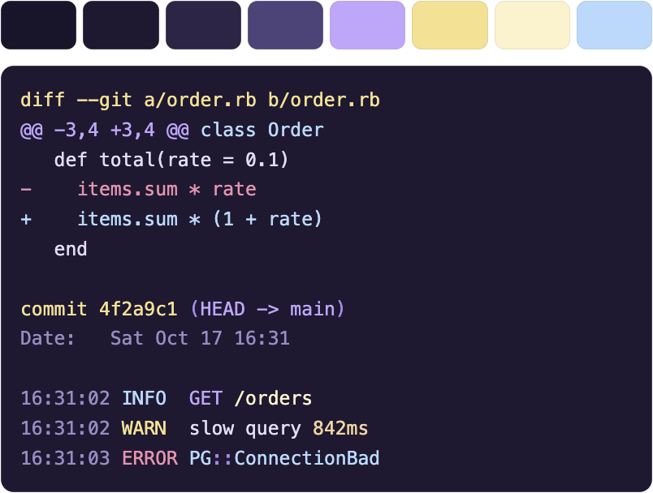
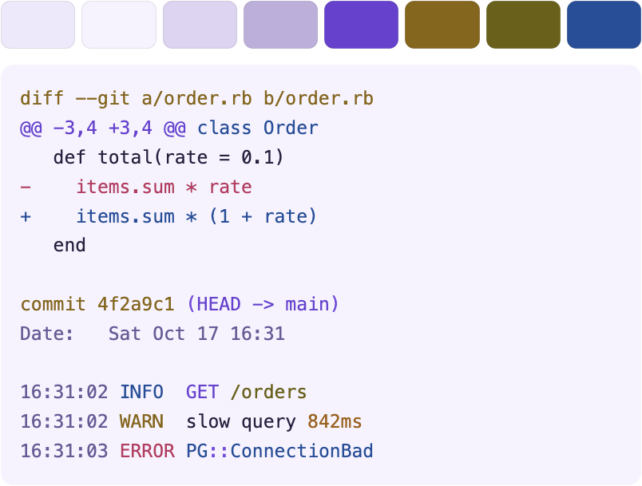

<h1> </h1>

A viewer for logs and command output in your terminal. It colors text by what kind it is, pages through long output, follows a log as it grows, and searches it with [fzf](https://github.com/junegunn/fzf) while it streams in.

- **Colors** each line by what it is. It detects the kind of input on its own: logs (unicorn, cron, rails, nginx, JSON lines, syslog) and the output of commands (`git`, `jj`, `go test`, `pytest`, `terraform`, `docker build`, `curl -v`, and more).
- **Pages** long output in a full-screen pager, like `less`.
- **Follows** a log that keeps growing, like `tail -f`.
- **Searches** with the real fzf. Press `/` at any time, while new lines keep arriving.
- **Previews** the lines around a result, so you can read a match in its context.

This is the dark theme:



And this is the light theme:



## Install

Both commands come in the same package.

**Homebrew** (macOS and Linux)

```
brew install styd/tap/magenta
brew install fzf        # optional, for the / search
```

**Go**

```
go install github.com/styd/magenta/cmd/...@latest
```

**Debian, Ubuntu, Fedora, Alpine**: download the `.deb`, `.rpm`, or `.apk` from the [releases page](https://github.com/styd/magenta/releases). They install both commands to `/usr/bin` and recommend (not require) `fzf`. On Debian or Ubuntu:

```
VERSION=0.1.0
curl -fsSLO https://github.com/styd/magenta/releases/download/v$VERSION/magenta_${VERSION}_linux_$(dpkg --print-architecture).deb
sudo apt install ./magenta_${VERSION}_linux_$(dpkg --print-architecture).deb
```

This is a plain package file, so `apt upgrade` does not update it. Repeat the steps for each release.

Ubuntu's own `fzf` package is older than the one the preview pane needs (0.49.0). Search still works with it. For a newer one, see [Older fzf versions](docs/paging-and-search.md#older-fzf-versions).

**Platforms**: the pager and search need a terminal. They are written for macOS, Linux, FreeBSD, OpenBSD, NetBSD, DragonFly, and Windows (the Windows console, with virtual terminal input, so Windows 10 or newer). Release archives are built for macOS, Linux, Windows, FreeBSD, and OpenBSD. Only macOS has been run by the author so far. The others are covered by CI, see [Development](docs/development.md). On any other system `mgnt` still colors as a plain filter.

**Release archives**: each `.tar.gz` / `.zip` holds both commands. On macOS, a downloaded archive may be quarantined by Gatekeeper ("cannot be opened because the developer cannot be verified"). The binaries are not signed or notarized. Installing with Homebrew avoids this, or run `xattr -d com.apple.quarantine mgnt magenta` after unpacking.

## Usage

The package has two commands:

| Command   | What it does |
|-----------|--------------|
| `mgnt`    | Shows logs and command output. Detects the kind of input, colors it, pages long output, follows a growing log, and searches it with fzf. |
| `magenta` | Manages the rules, colorschemes, and settings `mgnt` uses. It never shows logs. |

```
tail -f unicorn.log | mgnt         # follow a log
git log -p | mgnt                  # color a git log
git diff | mgnt
jj log | mgnt
go test ./... 2>&1 | mgnt
mgnt app.log                       # a file, paged if it is long
mgnt /var/log/nginx/access.log     # the file name is a hint too
magenta doctor                     # what mgnt sees: config, colors, fzf, start-up time
magenta colorscheme list
magenta colorscheme use mono       # colorschemes: magenta, mono
magenta config set theme light     # themes: auto, dark, light
magenta preview                    # every rule's sample lines in the current colorscheme
```

`mgnt` has almost no options on purpose: files (or stdin), `--help`, `--version`, and `--no-interactive`. Everything else is automatic or a setting in `config.toml`.

Color is always on, including when output is piped (`mgnt app.log | less -R` works). It is off only when `NO_COLOR` is set and non-empty, or `TERM=dumb`. The color depth (truecolor, 256 or 16) is picked from `COLORTERM` and `TERM`.

Lines are never changed: removing the color codes from the output gives back the input, byte for byte. (If the input has its own color codes, they are replaced by ours. Set `ansi = "keep"` to leave lines alone.) Lines longer than 64 KiB pass through uncolored.

Press `/` in the pager or in a followed log to search with fzf.

## Documentation

- [Paging and searching](docs/paging-and-search.md)
- [Settings](docs/settings.md)
- [Writing rules](docs/rules.md)
- [Colorschemes and themes](docs/colorschemes.md)
- [Troubleshooting](docs/troubleshooting.md)
- [Development](docs/development.md)

## Contributing

Bug reports, new rules for other commands and logs, and fixes are welcome. Open an issue or a pull request. [CONTRIBUTING.md](CONTRIBUTING.md) has the short version, and [Development](docs/development.md) explains how to build, test, and add a rule.

## License

[MIT](LICENSE)
