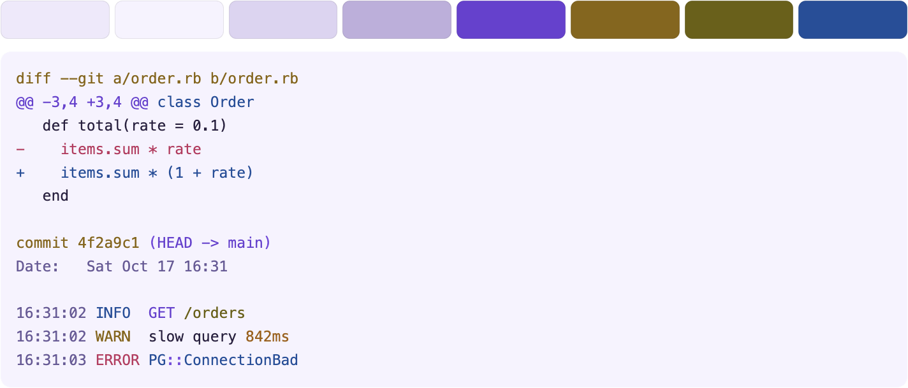

<h1> </h1>

A viewer for logs and command output in your terminal. It colors text by what kind it is, pages through long output, follows a log as it grows, and searches it with [fzf](https://github.com/junegunn/fzf) while it streams in.

```
tail -f unicorn.log | mgnt
git diff | mgnt
mgnt app.log
mgnt < change.diff
```

`mgnt` does more than color:

- **Colors** each line by what it is. It detects the kind of input on its own. That can be a log (unicorn, cron, rails, nginx, JSON lines) or the output of a command (`git log`, `git diff`). Anything else gets the generic rules for timestamps, levels, numbers, and the like.
- **Pages** long output, such as a big `git log`, in a full-screen pager that scrolls both ways, like `less`, with line numbers, chopping, and `n` and `N` to jump between matches.
- **Follows** a log that keeps growing, such as `tail -f`, and keeps your terminal's own scrollback.
- **Searches** with the real fzf. Press `/` at any time to search everything seen so far while new lines keep arriving.
- **Previews** the lines around a result, so you can read a match in its context.

Paging, following, and searching need a terminal, and searching also needs fzf. When the output is piped, `mgnt` is a plain color filter. See [Paging and searching](#paging-and-searching).

The default colorscheme is `magenta`. It has a dark theme and a light theme, and `mgnt` picks the one that matches your terminal. The top row of each picture is the palette, and the rest is a git diff, a git log, and an application log.

This is the dark theme:


And this is the light theme:



The package has two commands:

| Command   | What it does |
|-----------|--------------|
| `mgnt`    | Shows logs and command output. Detects the kind of input, colors it, pages long output, follows a growing log, and searches it with fzf. |
| `magenta` | Manages the rules, colorschemes, and settings `mgnt` uses. It never shows logs. |

## Install

Both commands come in the same package.

**Homebrew** (macOS and Linux)

```
brew install styd/tap/magenta
brew install fzf        # optional, for the / search
```

**Go**

```
go install github.com/styd/magenta/cmd/...@latest
```

**Debian, Ubuntu, Fedora, Alpine**: download the `.deb`, `.rpm`, or `.apk` from the [releases page](https://github.com/styd/magenta/releases). They install both commands to `/usr/bin` and recommend (not require) `fzf`.

**Platforms**: the pager and search need a terminal. They are written for macOS, Linux, FreeBSD, OpenBSD, NetBSD, DragonFly, and Windows (the Windows console, with virtual terminal input, so Windows 10 or newer). Release archives are built for macOS, Linux, Windows, FreeBSD, and OpenBSD. Only macOS has been run by the author so far. The others are covered by CI, see Development. On any other system `mgnt` still colors as a plain filter.

**Release archives**: each `.tar.gz` / `.zip` holds both commands. On macOS, a downloaded archive may be quarantined by Gatekeeper ("cannot be opened because the developer cannot be verified"). The binaries are not signed or notarized. Installing with Homebrew avoids this, or run `xattr -d com.apple.quarantine mgnt magenta` after unpacking.

## Quick start

```
git log -p | mgnt                  # color a git log
mgnt /var/log/nginx/access.log     # the file name is a hint too
magenta doctor                     # what mgnt sees: config, colors, fzf, start-up time
magenta colorscheme list
magenta colorscheme use mono       # colorschemes: magenta, mono
magenta config set theme light     # themes: auto, dark, light
magenta preview                    # every rule's sample lines in the current colorscheme
```

`mgnt` has almost no options on purpose: files (or stdin), `--help`, `--version`, and `--no-interactive`. Everything else is automatic or a setting in `config.toml`.

Color is always on, including when output is piped (`mgnt app.log | less -R` works). It is off only when `NO_COLOR` is set and non-empty, or `TERM=dumb`. The color depth (truecolor, 256 or 16) is picked from `COLORTERM` and `TERM`.

Lines are never changed: removing the color codes from the output gives back the input, byte for byte. (If the input has its own color codes, they are replaced by ours. Set `ansi = "keep"` to leave lines alone.) Lines longer than 64 KiB pass through uncolored.

## Paging and searching

When standard output is a terminal, `mgnt` is a pager as well as a colorizer, so `glo | mgnt` pages like `glo` itself would with `less` (git only starts its pager when its output is a terminal, which is why piping into something loses it). What it does depends on the input:

- **Short output** (it fits on the screen) is just printed and `mgnt` exits, like `less -F`.
- **A lot of output that arrives at once** (a command with its output ready, such as `git log`) opens a **full-screen pager that scrolls both ways**. The bottom two rows are laid out and colored like fzf's own header and info line: the keys in plain muted text, then the position (`lines 1-15 of 3749  0%`) followed by a rule across the width. While you page, `mgnt` reads only a few screens ahead, so the command writing into the pipe is held back, exactly as with `less`. `G` reads to the end.
- **A log that trickles in** (`tail -f app.log | mgnt`) is not paged: lines are printed as they arrive, into your normal terminal scrollback, which you scroll with the terminal as usual. Ctrl-C quits, and so does `q`.

Keys in the pager:

| | |
|---|---|
| `j`, `Down`, `Enter`, `Ctrl-N` | one line down |
| `k`, `Up`, `y`, `Ctrl-P` | one line up |
| `Space`, `f`, `PageDown`, `Ctrl-F` | one screen down |
| `b`, `PageUp`, `Ctrl-B` | one screen up |
| `d` / `u` | half a screen down / up |
| `g`, `Home` / `G`, `End` | the top / the end (`G` shows the end once the input has been quiet for a moment, so it works on a log that never ends) |
| `F` | **follow**: stay on the newest line as the input grows, like `less +F`. Any key stops it (a movement key also moves) |
| `w` | **chop** long lines instead of wrapping them (and back) |
| `h` / `l`, `Left` / `Right` | scroll sideways by half a screen, while chopping |
| `#` | show **line numbers** in a gutter |
| `n` / `N` | the **next / previous match** of your last search, wrapping at the ends |
| `/` | search with fzf (see below) |
| `q`, `Ctrl-C` | quit |

The mouse wheel scrolls too, in terminals that send arrow keys for the wheel on the alternate screen (`mgnt` turns that mode on. iTerm2, Terminal.app, kitty, WezTerm and xterm-based terminals do it, and tmux needs `mouse on`).

Things to know about the pager:

- It uses the terminal's **alternate screen**, like `less` does: when you quit, your terminal is exactly as it was before, and nothing from the log is left in its scrollback. (The followed-log view does not, and keeps native scrollback and selection.) Text can still be selected and copied with the mouse.
- You can scroll back through whatever the buffer holds: the last `buffer` lines (100,000 by default, and never fewer than 65,536). For a longer input the oldest lines are gone by the time you press `G`.
- Wrapped lines are counted by the rows they take, and scrolling moves by whole lines. The line numbers are those of the input (and of fzf's list: the hidden number in front of each of its lines).
- `n` and `N` use fzf's own matching: after a search, `mgnt` asks `fzf --filter` which lines match your query, with your `fzf_opts` (`--exact` and the like), so they agree with what the search found. They work on the lines read at that time, and are offered (the `n/N` hint) once the matches are in.
- Without fzf installed the pager works, and `/` just says there is no search. `TERM=dumb` terminals cannot be repainted, so they get plain printing.

Press **`/`** at any time to open **fzf** on the lines seen so far (up to `buffer` of them, 100,000 by default). Lines that arrive while fzf is open keep being added to its list. It is the real fzf: your `FZF_DEFAULT_OPTS`, key bindings and query syntax all apply. The prompt is at the bottom (mgnt passes `--layout default`, whatever `FZF_DEFAULT_OPTS` says, and you can override it with `fzf_opts` if you prefer another layout) and the newest line is nearest it.

- **Where the list starts:** a log that was already there (you were paged through it, like `git log`) is read from its first line, as in a pager: the list runs top to bottom starting at line 1, with the prompt at the bottom. A log that is still trickling in starts at its end, with the newest line nearest the prompt.
- **ctrl-o** accepts. In the pager it **jumps to the line** (the first one, if you marked several with Tab). In a followed log it prints the selected line(s), oldest first, into the scrollback and `mgnt` goes back to streaming, showing the lines that arrived meanwhile. **Enter** opens the preview instead (see below), and **Esc** leaves without doing anything. Change the key with `magenta config set keys.accept alt-p`, or set it to `enter` to give Enter back its usual job of printing.
- **Long lines** are shown whole: each matching line is wrapped over as many rows as it needs (a `↳` marks a continuation row), and not cut with `..`. This needs fzf 0.54.0 or newer. An older fzf can only stop the sideways scrolling and cuts a line at the edge of the screen. To get fzf's own cutting back, use `magenta config set fzf_opts --no-wrap`.
- The terminal is restored on every way out.

`mgnt` is a plain filter, and does not touch the terminal at all (no `/dev/tty`, no key handling, no paging), when output is not a terminal (`mgnt | less -R`), with `--no-interactive`, and on a system whose terminal it has no code for.

A search cannot stay on as a filter for the incoming stream: the fuzzy matching lives inside fzf.

### The preview pane

fzf's list only shows the lines that match, so the **preview pane** shows what surrounds the focused line: as many lines around it as fit, in their syntax colors, with the focused line marked by a `▶` in the margin. There are no line numbers, since in a log that streams they say nothing to the reader.

By default it sits **above** the list at half the height (`up,50%,wrap,border-bottom,hidden`) and starts **hidden**: typing and moving the cursor do not show it. **Enter** on a line opens it and moves you *into* it (its border says "Up/Down: scroll   Esc: back to the list"):

- **Up / Down** (also Ctrl-P/N/K/J) scroll the preview by a line, and **Page Up / Page Down** by a pane, while the list cursor stays where it is. The preview is not limited to the lines around the match: you can scroll through the whole buffer, up to its first line and down to its newest.
- **Esc** closes the preview and gives the keys back to the list. With the preview closed, Esc leaves fzf as usual.
- Opening it again starts centered on the focused line.
- **While it is open nothing else moves**, so you can study one result and its surroundings: the list is frozen (its label says `list paused`) and the preview keeps showing the line you chose. Lines that keep arriving from the log wait in `mgnt`'s buffer, nothing is lost, and they appear in the list when you press Esc.

This needs fzf 0.49.0 or newer. On older fzf the preview is simply always shown and Enter keeps printing the line. If you set your own `preview_window` without `hidden`, the preview is always shown and Enter and the movement keys are left alone. The keys run a small helper (`mgnt __preview --key ...`, one short process per key press) that tells fzf what to do, because fzf cannot decide by itself between scrolling the preview and moving the list.

- The **mouse wheel** over the preview scrolls it, three lines a notch.
- Toggle it with `ctrl-/` (like Enter and Esc, it opens and closes it. Change it with `magenta config set keys.preview_toggle alt-p`). Terminals do not pass the Cmd key to programs, so use a Ctrl or Alt combination. **On macOS, Alt combinations need your terminal to treat Option as Meta** (Terminal.app: Profiles > Keyboard > "Use Option as Meta key". iTerm2: Profiles > Keys > "Esc+").
- Turn it off with `magenta config set preview false`, and change the layout with `magenta config set preview_window "right,40%,wrap"`.
- How it works: while fzf is open, `mgnt` serves the lines over a Unix socket in a private temporary directory (mode 0700, removed afterwards). fzf runs `mgnt __preview` (a hidden subcommand) for each focused line. If that cannot reach `mgnt` it prints one dim line, `[mgnt] preview unavailable`, and nothing else.

### Older fzf versions

`fzf --version` runs once, the first time you press `/`. Anything older than the preview needs is handled without refusing to search, with one dim notice the first time:

| fzf | Behavior |
|-----|-----------|
| 0.49.0 or newer | full behavior: Enter opens the preview, Esc closes it |
| 0.27.0 up to 0.49.0 | preview pane with its border, but always shown (Enter prints, as usual) |
| 0.19.0 up to 0.27.0 | preview pane always shown, without the border |
| 0.18.0 up to 0.19.0 | the same, but no `ctrl-/` toggle (the key name does not exist yet) |
| older than 0.18.0 | no preview pane (the helper cannot learn the pane size) |

These versions were checked against the fzf git history (the first release containing each feature):

- 0.13.0: `--preview`, `--preview-window`, and `toggle-preview`
- 0.16.0: `wrap` in the preview window
- 0.17.4: `--layout`
- 0.18.0: `FZF_PREVIEW_LINES` and `FZF_PREVIEW_COLUMNS`
- 0.19.0: `ctrl-/` as a `--bind` key
- 0.27.0: `border-bottom` and the other `border-*` styles
- 0.37.0: `change-preview-label`
- 0.38.0: `show-preview` and `hide-preview`
- 0.43.0: the mouse wheel events over the preview
- 0.45.0: `transform`
- 0.49.0: `$FZF_PREVIEW_LABEL`, which is how the keys tell whether the preview is open
- 0.53.0: `--tail`, which lets fzf keep only as many lines as the buffer holds, so a search left open on a live log does not grow without bound
- 0.35.0: the `separator` color
- 0.36.0: the `scrollbar` color
- 0.54.0: `--wrap` for the list
- 0.58.0: the `input-bg` and `input-fg` colors, which give the search bar its own background

If you set `preview_window` or `fzf_opts` yourself, your flags are used exactly as written.

## Settings

`~/.config/magenta/config.toml` (or `$XDG_CONFIG_HOME/magenta/config.toml`). Change a setting with an editor or `magenta config set <key> <value>`. `mgnt` reads the file each time it starts.

| Key | Default | |
|-----|---------|---|
| `colorscheme` | `magenta` | the colorscheme to use, a name from `magenta colorscheme list` |
| `theme` | `auto` | `dark` or `light`, which palette of the colorscheme to use. `auto` picks one by the terminal background |
| `buffer` | `100000` | lines kept for the `/` search |
| `ansi` | `strip` | `strip` removes colors already in the input, and `keep` passes lines through untouched |
| `fzf_opts` | | extra fzf options, added after the ones `mgnt` needs |
| `preview` | `true` | show the preview pane |
| `preview_window` | `up,50%,wrap,border-bottom,hidden` | fzf's `--preview-window`. With `hidden` the preview opens on Enter and closes on Esc |
| `[keys] preview_toggle` | `ctrl-/` | key that opens or closes the preview |
| `[keys] accept` | `ctrl-o` | key that prints the selected lines (`enter` gives Enter that job back) |

The environment variable `MGNT_FZF_OPTS` adds fzf options after `fzf_opts`.

### Changing a setting for one run

Options of `mgnt` override `config.toml` for that run only and never write the file. The file is read first, then the options.

| Option | Same as | Example |
|---|---|---|
| `--colorscheme NAME` | `colorscheme` | `mgnt --colorscheme mono app.log` |
| `--theme auto\|dark\|light` | `theme` | `mgnt --theme light app.log` |
| `--ansi strip\|keep` | `ansi` | `mgnt --ansi keep app.log` |
| `--buffer LINES` | `buffer` | `tail -f app.log \| mgnt --buffer 500000` |
| `--fzf-opts "..."` | `fzf_opts` | `mgnt --fzf-opts "--exact --no-mouse"` |
| `--no-preview` | `preview = false` | `mgnt --no-preview` |
| `--set KEY=VALUE` | any setting above, including `preview_window` and `keys.*` | `mgnt --set preview_window=right,40% --set keys.accept=enter` |

`--set` can be repeated and is applied last, so it wins over the other options. A value that is not valid is refused with exit status 2 before any input is read, for example `--buffer lots`. These options belong to `mgnt`. `magenta` answers that they do.

### Old spellings

Before colorschemes had a setting of their own, `theme` named what is now a colorscheme. The old spellings still work, and `mgnt` and `magenta` say what to write instead:

| Old | Now |
|---|---|
| `theme = "mono"` in `config.toml` | `colorscheme = "mono"` |
| `theme = "magenta-dark"` or `"magenta-light"` | `colorscheme = "magenta"` and `theme = "dark"` or `"light"` |
| `mgnt --theme mono`, `--set theme=mono` | `mgnt --colorscheme mono`, `--set colorscheme=mono` |
| `magenta theme list`, `new`, `use`, and the rest | `magenta colorscheme list`, `new`, `use`, and the rest |
| `magenta theme use auto` | `magenta config set theme auto` |
| `magenta config set theme mono` | `magenta config set colorscheme mono` |

A directory `themes` in the config directory is not read any more. Move its files to `colorschemes`, and put their `[palette]` colors under `[palette.dark]` and `[palette.light]`. `magenta doctor` points out the old directory and the old settings.

## Writing rules and colorschemes

Built-in rules and colorschemes are inside the binaries. Files in the config directory add to them, and a file with the **same `name`** as a built-in one replaces it.

```
magenta init                  # copy the built-ins into the config dir for editing
magenta rule list
magenta rule new myapp        # a starter rule from a template
magenta rule edit unicorn     # opens $EDITOR on your copy, then checks it
magenta rule check            # errors with file and line
magenta preview myapp         # see the sample lines colored
magenta detect app.log        # how each rule scores a file, and which one mgnt picks
```

`edit` makes your copy from the built-in one if needed, opens `$VISUAL` / `$EDITOR`, and runs `check` when the editor exits.

### A rule file

```toml
name = "unicorn"
detect = ['^[IWEFD], \[\d{4}-\d\d-\d\dT[\d:.]+ #\d+\]']   # regexes for auto-detection
filenames = ["unicorn*.log"]                            # optional: a strong hint
sample = ['I, [2026-10-06T10:00:00.123 #4242]  INFO -- : worker=0 ready']

[[context.default.rule]]
regex    = '^([IWEFD]), \[([^\]]+) #(\d+)\]'
captures = ["level.letter", "timestamp", "pid"]   # one scope per capture group, "" skips one

[[context.default.rule]]
regex = '\bworker=\d+'
scope = "key"                                      # one scope for the whole match

# Optional multi-line state:
[[context.default.enter]]
regex = '^Traceback'
to    = "stacktrace"

[[context.stacktrace.rule]]
regex = '^\s+File "'
scope = "stack.frame"

[[context.stacktrace.exit]]
unless = '^\s+File "'     # the first line that does not match leaves the context
                           # and is processed again in "default"
```

- Regexes are Go's [RE2](https://github.com/google/re2/wiki/Syntax) syntax: no lookaround, no backreferences.
- **Rule order is priority.** Where matches overlap, the earlier rule keeps the bytes.
- A rule can use `prefix = "+"` instead of (or with) `regex` to test the start of a line cheaply, and `stop = true` to end rule processing for a line once it matches. The built-in `git-diff` uses both.
- Scopes are dotted names (`level.error`, `http.status.5xx`). A colorscheme that styles `string` also styles `string.quoted`.
- `magenta rule check` rejects invalid regexes (with file and line), unknown contexts, context cycles, a `captures` list that does not match the regex's groups, and any `sample` line that no rule matches. It warns about scopes that the built-in colorscheme does not style.
- **Detection**: `mgnt` looks at the first 10 lines (or whatever arrived within 50 ms), scores each rule by how many of those lines its `detect` regexes match, and picks the best one that reaches a threshold, otherwise `generic`. A matching `filenames` glob adds a strong bonus. It re-checks only after 100 lines in a row that the chosen rule does not recognize. `magenta detect <file>` shows the scores.

Built-in rules: `generic`, `git-log`, `git-diff`, `git-status`, `jj-log`, `jj-status`, `jj-diff`, `go-test`, `pytest`, `compiler`, `docker-build`, `terraform`, `curl-verbose`, `ping`, `syslog`, `unicorn`, `cron`, `rails`, `nginx-access`, `jsonl`.

### Colorschemes and themes

A **colorscheme** is a named set of highlighting colors, such as `magenta` or `mono`. The **theme** is its dark or light variant. They are two separate settings:

| Setting | Values | Default | One run |
|---|---|---|---|
| `colorscheme` | a name from `magenta colorscheme list` | `magenta` | `mgnt --colorscheme mono` |
| `theme` | `auto`, `dark`, or `light` | `auto` | `mgnt --theme light` |

```
magenta colorscheme list
magenta colorscheme use mono       # choose the colorscheme
magenta config set theme light     # choose the theme
```

`magenta` is the name of the project, of the command, and of the default colorscheme. This README says "the magenta command" and "the magenta colorscheme" where it could be unclear.

With `theme = "auto"`, `mgnt` finds out whether the terminal background is dark or light, see below.

### The magenta colorscheme

The default. Purple leads, then light yellow, then light blue, with a soft rose for errors. Despite the name, there is no magenta in the log colors. The one magenta is for fzf's marker and hints. It has a dark and a light theme, and every color of a theme is named in the palette of the file:

| Role | Dark | Light | Used for |
|---|---|---|---|
| `background`, `mantle` | `#1f1933`, `#19142a` | `#f7f3ff`, `#efe9fb` | the terminal's base and alternate backgrounds, which the contrast tests use |
| `surface0` | `#2d2547` | `#ded4f2` | the `/` search bar |
| `surface2` | `#4e437a` | `#bfaedd` | a stronger surface, such as a selection |
| `text` | `#e4dcf7` | `#2a2040` | plain text, such as context lines of a diff |
| `comment` | `#9a8cc6` | `#6a5a99` | timestamps, dates, `DEBUG`, meta lines |
| `keyword` | `#c3a6ff` | `#6b3fd4` | HTTP verbs, refs such as `HEAD -> main`, hunk headers, constants |
| `operator` | `#a98bf0` | `#7a4be0` | punctuation (not used by a built-in rule yet) |
| `symbol` | `#e0b8ff` | `#a23fc4` | the key of `key=value` |
| `function` | `#f7e08a` | `#8a6500` | `WARN`, commit hashes, diff file headers, commands |
| `string` | `#fbf3c8` | `#6b6000` | paths, URLs, quoted strings |
| `number` | `#f2d49b` | `#a35f00` | numbers, durations, sizes, process ids |
| `type` | `#b4daff` | `#174f9c` | `INFO`, class and module names, authors, added lines |
| `param` | `#9fc8f7` | `#2f6fc0` | the value of `key=value`, IP addresses |
| `error` | `#f28fb0` | `#c0305f` | `ERROR` and `FATAL` (bold), removed lines |
| `magenta` | `#e66bc0` | `#ae1e81` | the only magenta, for fzf's marker and the keys on top of the search. It has the hue of the logo, and is lighter or darker to stay readable |

Colors are 24 bit. On a terminal with 256 or 16 colors, `mgnt` picks the nearest color it has. `NO_COLOR` turns them all off.

While the pager or the `/` search is open, `mgnt` also gives the terminal the `background` and `text` colors of the theme, so the pager looks the same on any terminal. It does that with the OSC 10 and 11 escape sequences, and puts your own colors back when it ends, even after Ctrl-C. A log that is only streamed or piped is never painted.

fzf draws the `/` search, so `mgnt` gives it the colors of the theme too, with `--color` and fzf's own `dark` or `light` base. The styles that start with `ui.` say which: `ui.search` is the search bar (`surface0`, from fzf 0.58.0), `ui.current` the line under the cursor (`surface2`), `ui.marker` the marker and pointer (the magenta), `ui.hint` the keys on top (the magenta), `ui.info` the count, `ui.border` the lines, and `ui.background` the strip left of the list. A color that your fzf is too old to know is left out, and the rest still work. The footer of the pager uses the same colors, so it looks the same as the search. Your `fzf_opts` and `MGNT_FZF_OPTS` come last and win. Colors in `FZF_DEFAULT_OPTS` lose to the colorscheme for the names it sets, because command line options beat that variable.

A terminal that ignores OSC 10 and 11 just keeps its colors. To keep your terminal's and fzf's colors in every case, use a copy of the colorscheme without the `ui.` styles. `mono` has none.

**To copy and tweak it**, start a file of your own from it, or override the built-in one:

```
magenta colorscheme new mine        # a copy of the magenta colorscheme named "mine"
magenta colorscheme edit mine       # opens $EDITOR, then checks both themes
magenta colorscheme use mine
magenta colorscheme edit magenta    # or: your copy replaces the built-in one
```

To change one color, change its hex value in `[palette.dark]` or `[palette.light]`. Every style that uses it follows. To restyle one kind of thing, point its style at another role, for example `"timestamp" = { fg = "operator" }`.

### A colorscheme file

```toml
name = "mycolors"

[palette.dark]                   # named colors for the dark theme
purple  = "#c3a6ff"
rose    = "#f28fb0"

[palette.light]                  # and for the light theme
purple  = "#6b3fd4"
rose    = "#c0305f"

[styles]
"level.error" = { fg = "rose", bold = true }
"level.info"  = { fg = "purple" }
"diff.added"  = { fg = "green" }          # ANSI names, 0-255 indexes and #hex all work
"timestamp"   = { fg = 244 }
"ui.marker"   = { fg = "rose" }                      # fzf marker and pointer
```

The styles are shared by both themes, so a name like `rose` has to be in both palettes. A colorscheme with the palette of one theme only uses it for both, and one with no palette uses only hex colors, indexes, and ANSI names. `magenta colorscheme check` tests both themes.

Attributes: `bold`, `dim`, `italic`, `underline`, and `bg`. Colors are downgraded automatically for 256-color and 16-color terminals.

The built-in colorschemes are `magenta` and `mono`. `mono` has no color at all, only bold, dim, and underline, so its theme makes no difference.

### Dark or light: `auto`

With `theme = "auto"` (the default), `mgnt` finds out whether the terminal background is dark or light and uses the dark or the light theme of the colorscheme. It looks, in this order, at:

1. The `MGNT_BACKGROUND` variable, `dark` or `light`. Use it to force a choice.
2. The terminal's own answer to the background color question (the OSC 11 escape sequence). Many modern terminals answer, but not all do. This is only asked when `mgnt` is a pager on a terminal.
3. The `COLORFGBG` variable, which some terminals set.
4. Otherwise it assumes dark.

When `mgnt` is a plain filter (output piped), it never talks to the terminal, so it uses only 1, 3 and 4. A terminal that ignores the question costs a wait of up to 150 ms when `mgnt` starts as a pager. If that bothers you, pin a theme with `magenta config set theme dark`, or set `MGNT_BACKGROUND`. `magenta doctor` shows what `auto` decides from the environment. A pinned `dark` or `light` never asks the terminal.

## Troubleshooting

- `magenta doctor` shows the config directory, the colorscheme and theme, every rule file (built-in or user override), the color depth, the fzf it found and what that version supports, and the measured start-up time.
- A rule or colorscheme file with a mistake never stops a log from being shown: `mgnt` prints a warning and falls back (to the default colorscheme, or to the next rule).
- `tail -f app.log | magenta` is a common slip. `magenta` does not show logs and says so. Use `mgnt`.

## Development

### Requirements

- Go, at the version in `go.mod` (the dependencies need Go 1.26 or newer).
- `fzf` for the search. Tests that need the real one skip themselves when it is not installed, and everything else uses a fake.
- `tmux` is useful for trying the terminal behavior by hand (see below). Only `make smoke` needs it, together with the real `fzf`.

### Build and test

```
make build      # bin/mgnt and bin/magenta, with the version stamped in
make test       # go vet and go test ./...
make bench      # the engine and start-up benchmarks
make install    # go install of both commands
make smoke      # end to end check of the pager and search with the real fzf, through tmux
```

Before sending a change, run `gofmt -l .` (it should print nothing), `go vet ./...`, and `go test ./...`. For anything that touches goroutines, channels, or the terminal code, also run `go test -race ./...`. The whole suite takes under a minute. CI runs it on Linux, macOS, and Windows, then the smoke check on Linux and macOS, then Alpine (musl), then FreeBSD, OpenBSD, and NetBSD in virtual machines.

Some tests are timing sensitive on a slow machine. `MGNT_STARTUP_BUDGET_MS=50 go test ./internal/mgnt` raises the start-up budget (10 ms by default) for the one test that measures it.

### Layout

```
cmd/mgnt        the log viewer (a thin main)
cmd/magenta     the rule and colorscheme manager (a thin main)
assets.go       embeds rules/ and colorschemes/ into both binaries
rules/          built-in rule files (TOML)
colorschemes/   built-in colorschemes (TOML)
testdata/       one folder per built-in rule: in.log and the expected out.dark.ansi and out.light.ansi
internal/
  cli           the hints for using the wrong command, the version string
  config        config.toml, the config directory, finding built-in and user files
  rules         parsing, validating, and compiling rule files, the Loader interface
  colorscheme   colorscheme files and scope resolution (longest prefix wins)
  render        color depth, ANSI output, cutting and wrapping colored lines
  engine        applies a compiled rule file to one line at a time
  detect        scores the rule files against the first lines of a log
  lines         reads input in batches on its own goroutine
  pipe          samples the start of the log, picks a rule, colors the lines
  buffer        the ring buffer with sequence numbers
  tty           cbreak mode and reading keys from /dev/tty (Unix only)
  search        fzf: version handling, the feed, the preview server, and the helper
  mgnt          the mgnt command: plain filter, follow view, pager
  magentacli    the magenta command (cobra)
```

### How a line travels

1. `lines.Read` reads the input on a goroutine and sends batches. A batch ends when the reader has nothing buffered, which is also when output is flushed.
2. `pipe.Pipeline` holds the first lines (up to 10, or 50 ms) while `detect` chooses a rule file, then locks on. It re-checks only after 100 lines in a row that the rule does not recognize.
3. `engine.Highlighter` colors one line at a time. Rules claim bytes in order, so an earlier rule wins where matches overlap. Contexts (`enter` and `exit` tables) form a small state machine between lines. Removing the escape sequences from the output must always give the input back, byte for byte. A fuzz test guards this.
4. In `internal/mgnt`, a plain filter writes the lines out. On a terminal the lines go into the `buffer` ring first and a `view` shows them. It starts undecided, then becomes `follow` (printed as they arrive, into the scrollback) or `paging` (the full-screen pager) depending on whether a lot of output arrives at once.
5. `/` stops reading keys, gives the terminal back, and runs fzf through `search.Searcher`. It feeds fzf the whole ring and then each new line. While the fzf preview is open the feed is paused. The preview is drawn by `mgnt __preview`, which fzf runs for each focused line. It asks the running mgnt for the pane over a Unix socket. The same helper decides what the arrow keys and Esc do while the preview is open.

The ring buffer gives every line a number that is never reused. fzf is given `number<TAB>line` and shows only the text, so a selection comes back as a number and can be looked up for its colors.

### Testing

| Kind | Where | Notes |
|---|---|---|
| Golden files | `internal/engine` | `go test ./internal/engine -update` rewrites `testdata/*/out.dark.ansi` and `out.light.ansi`, the output of the magenta colorscheme in both themes. Read the diff before accepting it. |
| Fuzzing | `internal/engine` | `go test ./internal/engine -run xxx -fuzz FuzzHighlight -fuzztime 30s` |
| Property tests | `internal/render` | wrapping and cutting keep the text and the widths |
| A virtual terminal | `internal/mgnt/vscreen_test.go` | replays what a program wrote and says what is on the screen. The pager tests assert on that instead of on escape sequences. |
| A fake terminal | `internal/mgnt/interactive_test.go` | `fakeTerm` records cbreak and restore, and feeds keys |
| A fake fzf | `interactive_test.go` and `internal/search` | a shell script on a temporary path that records its arguments and what it was fed |
| Real pseudo terminals | `internal/tty` | cbreak, restore, the key reader, window size |
| The real fzf | `internal/search` | ordering, query matching. Skipped when fzf is missing. |
| The whole program in tmux | `test/smoke.sh` | builds `mgnt`, pages a log, searches, opens and closes the preview, and quits. It needs `tmux` and `fzf`, and uses a private tmux server. |

Things that make tests dependable: the Env structs of `mgnt` and `magenta` replace the terminal, signals, `PATH` lookups, standard streams, and the environment. Tests set `XDG_CONFIG_HOME` to a temporary directory so a developer's own config never leaks in. Tests that wait for output poll with a deadline instead of sleeping.

The version thresholds for fzf features live in `internal/search/fzfversion.go`, each with the commit that introduced the feature. Check new ones against fzf's git history (`git log -S` on the option name, then the first tag that contains the commit), not against summaries of its changelog.

### Trying the terminal behavior by hand

The pager and the search are best checked in a real terminal. A private tmux server keeps this safe and repeatable. Never run `tmux kill-server` without `-L`, because that would end your own sessions.

```
go build -o /tmp/mg/mgnt ./cmd/mgnt
T() { tmux -L mgdev -f /dev/null "$@"; }
T new-session -d -s t -x 100 -y 30 "env XDG_CONFIG_HOME=/tmp/mg/cfg TERM=xterm-256color bash --norc --noprofile"
T send-keys -t t 'git log --oneline | /tmp/mg/mgnt' Enter
T send-keys -t t j j j        # keys
T capture-pane -t t -p        # what is on the screen (add -e to see colors)
T kill-server                 # only the private one
```

### Adding a rule file

1. Write `rules/<name>.toml` with `name`, `detect` patterns, optional `filenames` globs, `sample` lines, and the `[[context.default.rule]]` tables. `magenta rule check rules/<name>.toml` reports problems with file and line.
2. Add `testdata/<name>/in.log` with a realistic log (include the awkward lines) and run the golden update once.
3. Add the name to the list in `TestExpectedBuiltins` (`internal/rules`). The other tests pick the file up by themselves: validity, samples being matched, byte preservation, and detection of its own log.
4. Use only scopes the colorschemes style. Add a new scope to the `magenta` colorscheme, and keep one hue for one kind of thing across rules.

### Adding a colorscheme

Add `colorschemes/<name>.toml`, and list it in the colorscheme tests (`internal/colorscheme`). Colors that are meant for reading have to meet the contrast numbers in `TestContrast` (4.5:1 against the background of the theme, and 4:1 for comments). Keep the colors in the palette and the styles pointing at them. The Go code has no color values of its own.

### Adding a setting

Add the field to `config.Config` with its default and validation, to `SettingKeys`, `Get` and `SetFile` in `internal/config/config.go`, and to the table above. `magenta config set` rewrites only the line it changes and keeps comments.